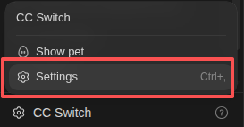
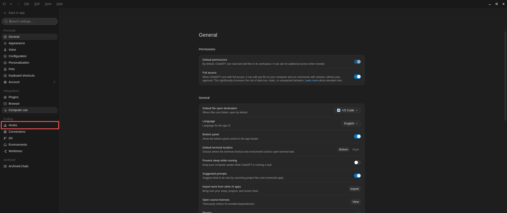

<h1 align="center">Airup</h1>

<p align="center">
  
</p>

<p align="center">
  面向各类 AI Agent 工具的工程工作流与 agent harness，让 AI 先理解、再计划、后执行。
</p>

<p align="center">
  
  
  
</p>

<p align="center">
  
  
  
  
</p>

## Scope

Airup 将需求澄清、设计、实现、测试、评审与交付串成可组合的工程流程，目标是支持各类 Agent 工具，让同一套工程方法能够随任务迁移到不同宿主。

- `skills` 提供任务路由、DDD、TDD、调试、评审、验证和发布等工作流。
- `hooks` 在关键操作前后执行分支保护、状态检查、格式化与运行时资产引导。
- MCP 接入用于连接外部工具和工程系统，具体可用能力取决于宿主配置。
- `agent` 定义专门角色，`agent harness` 承载任务执行、编排、约束和反馈。
- 宿主适配层负责对接各工具的插件、技能发现和生命周期接口。

工作流尽量共享，插件入口、hooks 和角色加载方式按宿主适配。支持范围以仓库已有的适配文件为准；不同工具中的能力会随适配进度逐步补齐。

## Agent Support

| Agent 工具 | 当前接入方式 | 范围 |
| --- | --- | --- |
| ChatGPT / Codex / Codex CLI | Codex 插件 | 已提供 skills、hooks 和插件展示配置 |
| Cursor | 本地插件 | 已提供 skills 和 Cursor hooks |
| OpenCode | 本地 TypeScript 插件与 skills 路径 | 已提供适配入口 |
| Claude Code、GitHub Copilot、Cline 及其他 Agent 工具 | 后续适配 | 尚未提供专用安装入口 |

上表说明当前仓库提供的入口，不代表所有宿主已经具备相同能力。其他工具可根据自身的技能加载机制评估复用 `skills/`；hooks、专门角色和执行约束需要对应的宿主适配。

## Installation Plugin or Update Plugin

### ChatGPT / Codex and Codex CLI

<details>
<summary>安装、更新与 hooks 设置</summary>

安装插件：

```bash
codex plugin marketplace add LiTeXz/airup
codex plugin marketplace upgrade airup
codex plugin add airup@airup
```

更新 marketplace 快照并刷新插件：

```bash
codex plugin marketplace upgrade airup
codex plugin add airup@airup
```

完成后，重新打开 Codex 任务。

在 Codex Desktop 中，hooks 需要用户在 `Settings` → `Hooks` 中显式开启。




</details>

### Cursor

<details>
<summary>从本地仓库安装</summary>

先下载本仓库，再在仓库根目录执行对应平台的命令。

Linux 和 macOS：

```bash
mkdir -p ~/.cursor/plugins/local
ln -s "$(pwd)" ~/.cursor/plugins/local/airup
```

Windows PowerShell：

```powershell
New-Item -ItemType Directory -Force "$HOME\.cursor\plugins\local"
New-Item -ItemType Junction -Path "$HOME\.cursor\plugins\local\airup" -Target (Get-Location)
```

插件通过 `.cursor-plugin/plugin.json` 声明入口，加载 `skills/` 和 `hooks/hooks.cursor.json`。Cursor hooks 会在会话开始时更新受保护分支，在 Shell 工具执行前阻止 Agent 直接提交或推送 Git 变更，并在编辑后运行适用的格式化检查。

更新本地仓库后，重新打开 Cursor 会话以加载变更。

</details>

### OpenCode

<details>
<summary>配置本地插件与 skills</summary>

下载本仓库后，在项目的 `opencode.json` 中添加：

```json
{
  "$schema": "https://opencode.ai/config.json",
  "plugin": ["/absolute/path/to/airup/.opencode/plugin/airup.ts"],
  "skills": {
    "paths": ["/absolute/path/to/airup/skills"]
  }
}
```

将示例路径替换为本仓库的实际路径，然后重新启动 OpenCode。更新本地仓库后，同样需要重新启动以加载变更。

</details>

### Other Agents

Airup 的适配目标包括 Claude Code、GitHub Copilot、Cline 以及其他 Agent 工具。专用适配入口会随实现加入本仓库，安装方式也会在此补充。

如果使用的工具能够加载 `SKILL.md`，可以通过该工具支持的方式接入所需技能。技能加载与 hooks、角色和权限机制分别由宿主处理，不能仅凭加载技能就认为全部执行约束已经生效。

## Usage

1. 在所用 Agent 工具中安装插件或配置技能加载路径，按宿主要求启用 hooks。
2. 描述目标、约束与验收条件；宿主支持时，可先进入 Plan 模式。
3. 使用 `airup-dev-engineering-workflow-route` 选择工作流，再按任务需要完成澄清、建模、计划和实现。
4. 完成前运行相应验证，记录结果、未验证范围与剩余问题。

长任务通过检查点保留进度；需要多角色协作时，结合宿主提供的 agent 能力执行。可用角色和自动触发方式取决于当前适配。

## Safeguards

在已接入相应保护机制的宿主中，Airup 会对 `main`、`dev`、`develop`、`devlop` 等集成分支提醒创建新分支，并按宿主配置限制直接写入、提交或推送。请通过功能分支和 PR 完成变更。

hooks 需要正确加载并启用。仅导入 skills 不会自动获得宿主级操作拦截能力。

## Why Airup

Airup 表达的是“让工程能力向上流动”：把工程方法、工具、运行环境与反馈连接起来，让 Agent 的执行过程能够被理解、检查和持续改进。

编码、单元测试和功能性测试是核心开发活动，支撑它们的服务、数据、自动化、可观测性与运行环境同样属于交付范围。集成测试验证真实协作边界，属性测试扩大输入空间，灰度测试验证受控发布风险，线上问题排查测试把真实故障转化为可复现的回归证据。应按风险选择最小有效层级，并保留环境与运行证据。

仓库和包的 slug 使用 `airup`，展示名称使用 `Airup`；Codex 的 plugin 标识使用 `airup@airup`。其他宿主使用各自的接入格式，共享同一项目名称与工程工作流。

## Migration and Compatibility

- 当前仓库、插件、包与 marketplace 统一使用 `airup`，展示名称统一使用 `Airup`。
- 面向用户的安装命令、配置示例和新代码使用当前名称，不提供旧标识别名。
- 历史 Git 提交、标签和发布记录保持不变，不重写已经发布的来源信息。
- GitHub 仓库重命名后的旧地址仅作为平台重定向兼容入口，新引用使用当前仓库地址。
- 引用上游、第三方来源或历史记录时保留原始归属，并明确标注历史来源。
- 新增宿主适配复用共享工作流，分别说明技能、hooks、角色与执行约束的支持范围。

## More

- [参与贡献](CONTRIBUTING.md)
- [GNU General Public License v3.0](LICENSE)
